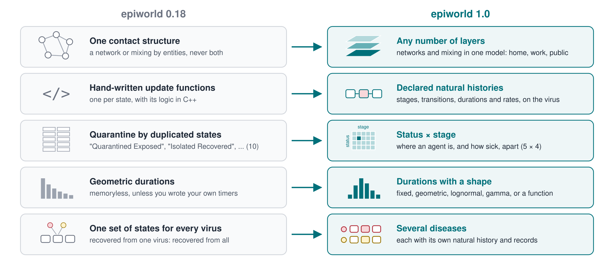
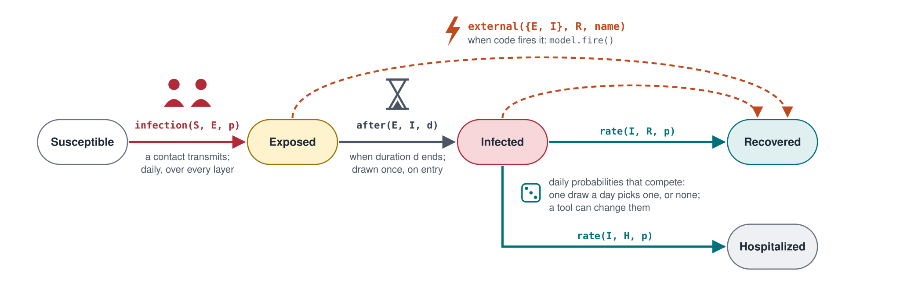
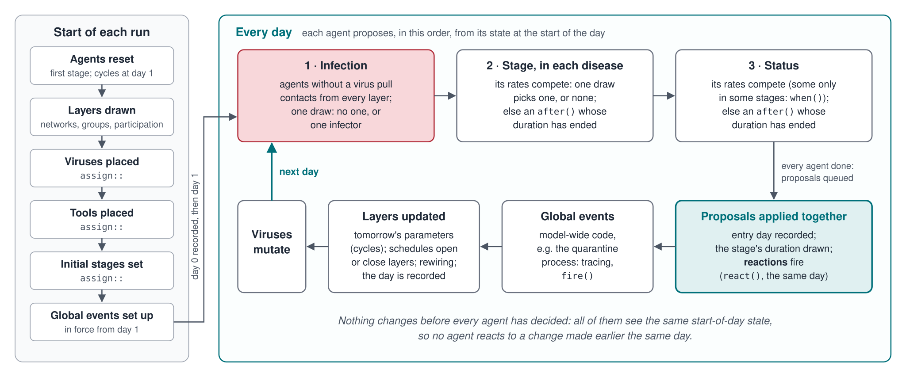
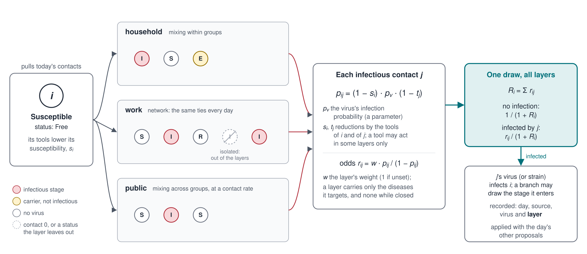
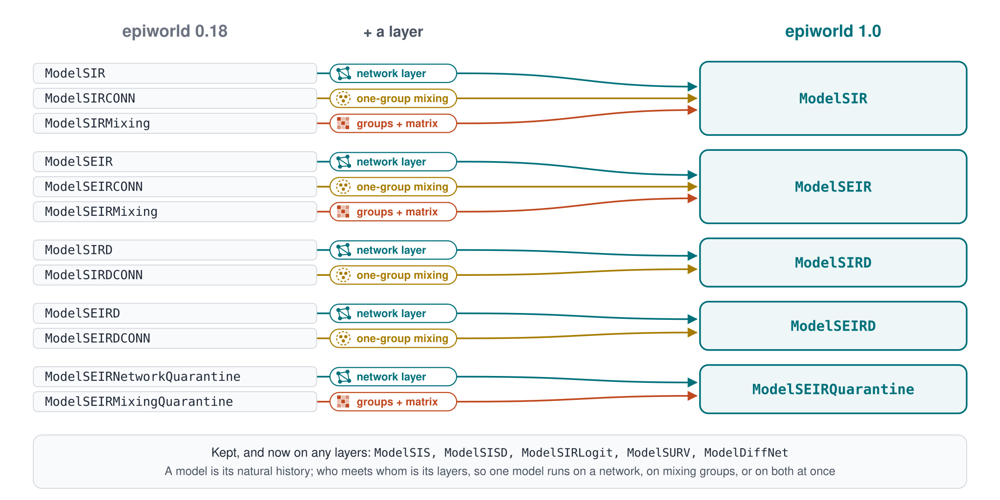
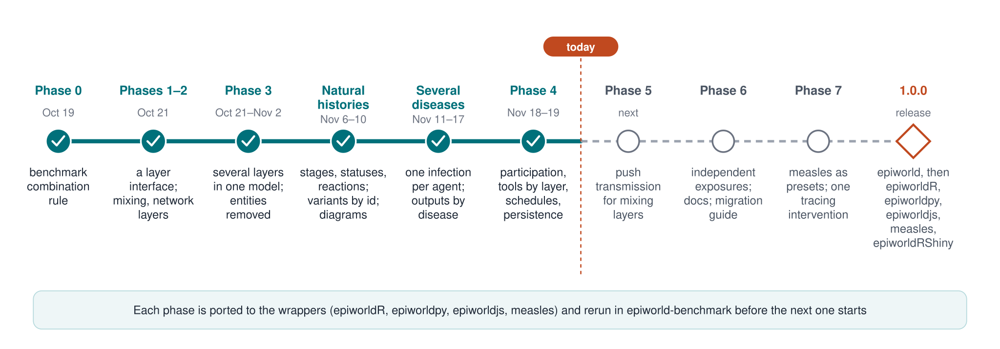

```{r}
#| label: setup
library(ggplot2)
library(data.table)
library(epiworldR)
dir.create("build", showWarnings = FALSE)

# summary(model) without its empty sections (or only some: `only`, a regex
# on a section's first line; `zero = FALSE` hides all-zero rows), for a slide
summary_brief <- function(
    model,
    drop = c("Global events", "Tool\\(s\\)", "Transition Probabilities"),
    only = NULL,
    zero = TRUE
) {
  out    <- capture.output(summary(model))
  if (!zero)
    out <- out[!grepl(": +0 -> 0$", out)]
  blocks <- split(out, cumsum(out == ""))
  blocks <- lapply(blocks, function(b) b[b != "" & !grepl("^_+$", b)])
  keep   <- vapply(
    blocks,
    function(b) {
      length(b) > 0 &&
        !grepl(paste(drop, collapse = "|"), b[1]) &&
        (is.null(only) || grepl(only, b[1]))
    },
    logical(1)
  )
  cat(unlist(lapply(blocks[keep], c, "")), sep = "\n")
}

# The C++ behind a slide: the parts of an example between its
# `// slide-begin` and `// slide-end` markers, one column each
cpp_blocks <- function(
    file,
    widths = NULL
) {
  x     <- readLines(file)
  begin <- grep("// slide-begin", x, fixed = TRUE)
  end   <- grep("// slide-end", x, fixed = TRUE)
  if (is.null(widths))
    widths <- rep(floor(100 / length(begin)), length(begin))
  cat(":::: {.columns}\n")
  for (i in seq_along(begin)) {
    code   <- x[(begin[i] + 1):(end[i] - 1)]
    indent <- min(nchar(sub("^( *).*", "\\1", code[code != ""])))
    cat(
      sprintf("::: {.column width=\"%d%%\"}\n", widths[i]),
      "```cpp\n",
      paste(substring(code, indent + 1), collapse = "\n"),
      "\n```\n:::\n",
      sep = ""
    )
  }
  cat("::::\n")
}
theme_set(
  theme_minimal(base_size = 16) +
    theme(legend.position = "top", panel.grid.minor = element_blank())
)
# The theme's accent (teal) and its "results" rust lead; then gold and navy
# epiworld 1.0 over 0.17.1 in the benchmark, across its 8 scenario sizes
bench_range <- function(what) {
  r <- dcast(
    fread("results/benchmark_runs.csv")[engine %in% c("epiworld", "epiworld-v1")],
    scenario + n ~ engine,
    value.var = what
  )
  x <- r[["epiworld-v1"]] / r[["epiworld"]]
  sprintf("%.2f–%.2f", min(x), max(x))
}

pal <- c("#00707a", "#c0491f", "#d39e00", "#1f2a44")
```

<!--
  About 30 minutes. Three parts:
  1. What changed and why (slides 2-5)
  2. Before and after, side by side (slides 6-17)
  3. New capabilities, with runs (slides 18-28)
  Then what is next.

  The four examples of "New capabilities" are R, run when the slides render
  (epiworldR 1.0). Their C++ equivalents are in the appendix, taken from
  examples/*.cpp (between the `// slide-begin` and `// slide-end` markers) and
  built against the vendored epiworld v1-layers header (vendor/VERSION):
  `make results`.
-->

## Why a 1.0? {.nostretch}

{width="100%" fig-alt="What epiworld 0.18 made hard and what 1.0 does: one contact structure becomes any number of layers; hand-written update functions become declared natural histories; quarantine by duplicated states becomes status times stage; geometric durations become durations with a shape; one set of states for every virus becomes several diseases."}

## By the numbers

:::: {.columns}
::: {.column width="33%"}
[20 → 12]{.big-number}

model headers in `models/` (5,596 → 2,080 lines)
:::
::: {.column width="33%"}
[10 → 5 × 4]{.big-number}

the SEIR quarantine model: 10 hand-written states became 5 stages × 4 statuses, on any layers
:::
::: {.column width="33%"}
[≈ 1.0×]{.big-number}

simulation time against 0.17.1 on the benchmark scenarios (`r bench_range("simulate")`), with less memory (`r bench_range("peak")`)
:::
::::

<br>

- The engine stayed about the same size (23,000 → 24,000 lines of headers) while doing more
- The measles library shrank from 4,108 to 2,783 lines

<!-- Memory: peak 0.57-0.96 of 0.x in the NH-5b-2 rerun (epiworld-benchmark #40). -->

## epiworld 1.0 among other engines

::: {.feature-table}
| Feature | epiworld 0.18 | **epiworld 1.0** | Covasim | Starsim | EoN | epydemic | ixa | individual | ABM | EpiModel | FRED | Agents.jl |
|:---|:--:|:--:|:--:|:--:|:--:|:--:|:--:|:--:|:--:|:--:|:--:|:--:|
| Language | C++, R, Py | C++, R, Py | Python | Python | Python | Python | Rust | R | R | R | C++ | Julia |
| Ready-made disease models | ● | ● | ● | ● | ● | ● | ○ | ○ | ○ | ● | ● | ○ |
| User-defined states, transitions | ● | ● | ◐ | ● | ● | ● | ◐ | ◐ | ● | ● | ● | ◐ |
| Continuous-time simulation | ○ | ○ | ○ | ○ | ● | ● | ● | ○ | ● | ○ | ○ | ◐† |
| Network from an edge list | ● | ● | ● | ● | ● | ● | ● | ◐ | ◐ | ◐ | ◐ | ◐ |
| Vaccination | ● | ● | ● | ● | ◐ | ◐ | ◐ | ◐ | ◐ | ◐ | ● | ◐ |
| Layered contacts | ◐† | [●]{.chg} | ●† | ◐† | ○ | ◐† | ◐† | ◐† | ◐† | ●† | ●† | ◐† |
| Age and other attributes | ◐† | ◐† | ●† | ●† | ◐† | ◐† | ●† | ●† | ●† | ●† | ●† | ●† |
| Demography | ◐† | ◐† | ◐† | ●† | ○ | ◐† | ◐† | ◐† | ●† | ●† | ◐† | ◐† |
| Movement in space | ○ | ○ | ○ | ○ | ○ | ○ | ◐† | ◐† | ◐† | ○ | ◐† | ●† |
| Testing, tracing, quarantine | ●† | ●† | ●† | ◐† | ○ | ◐† | ◐† | ◐† | ◐† | ◐† | ◐† | ◐† |
| Several pathogens or variants | ◐† | [●]{.chg}† | ●† | ●† | ◐† | ◐† | ◐† | ◐† | ◐† | ◐† | ●† | ◐† |
| Built-in calibration | ●† | ●† | ●† | ●† | ○ | ○ | ○ | ○ | ○ | ○ | ○ | ◐† |
:::

<span class="small">● provides it; ◐ possible with the user's own code; ○ not provided; † not tested by the benchmark. Highlighted: what 1.0 adds, **a model with several layers** (0.18: a network *or* mixing) and **several diseases**, each with its own natural history (0.18: variants of one). <span class="muted">Other engines: the feature table of epiworld-benchmark (their documentation, not a systematic review).</span></span>

<!-- Source: epiworld-benchmark, docs/engines.md ("Feature summary"), branch
     v1-layers, where epiworld is one "epiworld family" column. Split here:
     0.18 keeps the family's marks except layered contacts (the family's mark
     came from entities; a 0.18 model has one contact structure) and several
     pathogens (0.18 viruses share the model's states: variants of one
     disease). -->

# Part 1 -- Before and after {background-color="#00707a"}

## Hello world

:::: {.columns}
::: {.column width="50%" .before}
### 0.18

```cpp
epimodels::ModelSIR<> hello(
    "COVID-19", // Name of the virus
    0.01,       // Initial prevalence
    0.1,        // Transmission probability
    0.3         // Recovery probability
);

// The population comes from the network
hello.agents_smallworld(100000, 10L, false, .01);

hello.run(100, 122);
hello.print();
```
:::
::: {.column width="50%" .after}
### 1.0

```cpp
epimodels::ModelSIR hello(
    "COVID-19", // Name of the virus
    100000,     // Number of agents
    0.01,       // Initial prevalence
    0.1,        // Transmission probability
    0.3         // Recovery probability
);

// Contacts come from layers
hello.add_layer(layer::network(
    "contacts", graph::smallworld(10, .01)
));

hello.run(100, 122);
hello.print();
```
:::
::::

- The model owns its population (`n`); networks are **layers**, drawn anew for every run
- No template parameter: `ModelSIR`, `Model`, `Virus` are plain classes

## Building a model from scratch

:::: {.columns}
::: {.column width="50%" .before}
### 0.18

```cpp
Model<> model;
model.add_state("Susceptible",
    default_update_susceptible<>);
model.add_state("Infected",
    default_update_exposed<>);
model.add_state("Recovered");

Virus<> virus("covid 19", 100, false);
virus.set_prob_infecting(.10);
virus.set_prob_recovery(.30);
virus.set_state(1, 2);

model.add_virus(virus);
model.agents_smallworld(100000, 10L, false, .01);
```
:::
::: {.column width="50%" .after}
### 1.0

```cpp
Model model(100000);

Virus virus("covid 19");
virus.add_stage("Susceptible");
virus.add_stage("Infected", stage::infectious);
virus.add_stage("Recovered");
virus.infection(0, 1, 0.10);
virus.rate(1, 2, 0.30).effect(Effect::recovery);

model.add_virus(virus, assign::count(100));
model.add_layer(layer::network(
    "contacts", graph::smallworld(10, .01)
));
```
:::
::::

- The **virus carries its natural history**: stages and the transitions between them
- Every number becomes a **model parameter** (`"covid 19: Infected -> Recovered"`), changeable with `set_param()`

## Four kinds of transitions {.nostretch}

{width="100%" fig-alt="The four kinds of transitions on a flu model: infection(S, E, p) when a contact transmits; after(E, I, d) when a duration drawn on entry ends; rate(I, R, p) and rate(I, H, p), daily probabilities that compete; external({E, I}, R, name), fired by code."}

```cpp
flu.after(E, I, Duration::lognormal(3.0, 1.0));           // shaped duration
flu.rate(I, R, "Recovery rate").effect(Effect::recovery); // a tool can speed it up
flu.rate(I, H, "Hospitalization rate");                   // competes with recovery
flu.external({E, I}, R, "Antiviral cure");                // fired by an intervention
```

<!-- Rates compete through one roulette draw (odds); a rate plus a branch,
     .to({{R, 0.9}, {H, 0.1}}), gives exact probabilities. Docs page:
     docs/impl/natural-history-and-statuses.md -->

## A day in an epiworld 1.0 model {.nostretch}

{width="100%" fig-alt="How an epiworld 1.0 model runs: set-up at the start of each run, then each day every agent proposes an infection, stage changes and a status change, which are applied together before global events run and the day is recorded."}

<span class="small">Infection first, then each disease's stage, then the status; every proposal is applied at once, at the end of the day.</span>

<!-- fig/diagrams/epiworld-day.svg, drawn from Model::run(), reset(),
     update_state() and nh_step() (epiworld v1-layers). -->

## Custom logic: a community and a hospital

:::: {.columns}
::: {.column width="50%" .before}
### 0.18: one update function per state

```cpp
inline void update_infected(Agent<int> * p, Model<int> * m)
{
    auto hm = static_cast<CommunityHospModel*>(m);
    std::vector< epiworld_double > probs = {
        m->par("Prob hospitalization"),
        m->par("Prob recovery")
    };
    int res = roulette<>(probs, m);
    if (res == 0)
        p->change_state(*m, hm->infected_hospitalized_state);
    else if (res == 1)
        p->rm_virus(*m, hm->susceptible_state);
}
// ... update_susceptible, update_infected_hospitalized,
// a sampler excluding the hospitalized, a model class
```
:::
::: {.column width="50%" .after}
### 1.0: declarations

```cpp
Virus mrsa("MRSA");
mrsa.add_stage("Susceptible");
int inf  = mrsa.add_stage("Infected", stage::infectious);
int hosp = mrsa.add_stage("Infected (hospitalized)",
                          stage::carrier);

// Hospitalized carriers don't transmit
mrsa.infection(0, inf, 0.1).to({
    {inf,  Value::complement("Prob hospitalization")},
    {hosp, "Prob hospitalization"}
});
mrsa.rate(inf, hosp, "Prob hospitalization");
mrsa.rate(inf, 0, "Prob recovery");
mrsa.rate(hosp, 0, "Prob recovery");
mrsa.rate(hosp, inf, "Discharge infected");
```
:::
::::

<!-- examples/14-community-hosp in both versions: about 130 lines before,
     45 after. -->

## Mixing: from entities to layers (R)

:::: {.columns}
::: {.column width="50%" .before}
### epiworldR 0.x

```r
e1 <- entity("Population 1", 3e3, as_proportion = FALSE)
e2 <- entity("Population 2", 3e3, as_proportion = FALSE)
e3 <- entity("Population 3", 3e3, as_proportion = FALSE)

flu_model <- ModelSEIRMixing(
  name              = "Flu",
  n                 = 9e3,
  prevalence        = 1 / 9e3,
  transmission_rate = 0.1,
  recovery_rate     = 1 / 7,
  incubation_days   = 7,
  contact_matrix    = cmatrix
)

flu_model |>
  add_entity(e1) |>
  add_entity(e2) |>
  add_entity(e3)
```
:::
::: {.column width="50%" .after}
### epiworldR 1.0

```r
groups <- rep(0:2, each = 3e3)

flu_model <- ModelSEIR(
  name              = "Flu",
  n                 = 9e3,
  prevalence        = 1 / 9e3,
  transmission_prob = 0.1,
  latent_period     = 7,
  recovery_rate     = 1 / 7
)

add_layer(
  flu_model,
  layer_mixing(
    "community",
    groups         = groups,
    contact_matrix = cmatrix
  )
)
```
:::
::::

- `ModelSEIRMixing` is gone: **the plain model plus a mixing layer**. Entities are gone: groups are a layer's membership.

## Layers, three kinds

:::: {.columns}
::: {.column width="50%"}
```cpp
// A network: the same contacts every day
layer::network("work", graph::smallworld(10, 0.05));

// Mixing with a contact matrix: strangers, by group
auto pub = layer::mixing("public");
pub->set_groups(assign::shares(
    {{0, 0.25}, {1, 0.5}, {2, 0.25}}), 3u);
pub->set_contact_matrix({0.6, 0.3, 0.1,
                         0.2, 0.6, 0.2,
                         0.1, 0.4, 0.5});
pub->set_contact_rate("Public contact rate");

// Mixing within groups: households, classrooms
auto home = layer::mixing("household");
home->set_groups(assign::labels(household), n / 4u);
home->set_contact_prob({0.5});
```
:::
::: {.column width="50%"}
- A model has **any number of layers**; each infection draw combines the contacts of all of them
- Each transmission records **its layer**
- Layers can **log contacts** for tracing (`enable_tracing()`)
- A layer can be restricted to **some diseases** (`add_target("Measles")`)
- Groups come from the same **`assign::`** vocabulary as viruses and tools
:::
::::

## Where an infection comes from {.nostretch}

{width="100%" fig-alt="A susceptible agent pulls its contacts from every layer; each infectious contact gives a probability reduced by both agents' tools, the layer's weight scales its odds, and one draw over all layers picks no infection or one infector."}

<span class="small">All layers feed **one** draw (not one chance per layer), and the draw records the layer: `get_transmissions()`.</span>

<!-- fig/diagrams/epiworld-infection.svg, drawn from nh_step_infection() and
     the exposure loop of model-meat-transmission.hpp (epiworld v1-layers). -->

## Fewer models {.nostretch}

{width="80%" fig-alt="Twelve 0.18 models that differed only in their contacts map onto five 1.0 models plus a layer: a network layer, a one-group mixing layer, or a mixing layer with groups and a contact matrix."}

::: {.small}
Also gone: entities (a layer's membership now) and `Model<TSeq>`. **A registry** builds every model by name: `make_model("SEIR", values)`.
:::

<!-- fig/diagrams/epiworld-models.svg, from include/epiworld/models/ on
     epiworld master (0.18) and v1-layers. -->

## Placing viruses, tools and groups

:::: {.columns}
::: {.column width="50%" .before}
### 0.18: one function family per target

```cpp
virus.set_distribution(
    distribute_virus_randomly<>(0.01));
model.add_virus(virus);

Tool<> mask("Mask");
mask.set_susceptibility_reduction(.3);
mask.set_distribution(
    distribute_tool_randomly<>(.3, true));
model.add_tool(mask);

// To entities:
distribute_tool_to_entities<>(...);
```
:::
::: {.column width="50%" .after}
### 1.0: `assign::`, everywhere

```cpp
model.add_virus(virus, assign::share(0.01));

Tool mask("Mask");
mask.set_susceptibility_reduction(.3);
model.add_tool(mask, assign::share(.3));

// The same vocabulary for initial stages
// and a layer's groups
model.set_initial(assign::shares({{R, 0.2}}));
layer->set_groups(assign::labels(group), k);
model.add_tool(vax, assign::group_shares(...));
```
:::
::::

<span class="small muted">`share`, `count`, `shares`, `counts`, `group_shares`, `group_counts`, `agents`, `labels`, `by`</span>

## Statuses: where an agent is, apart from its stage

:::: {.columns}
::: {.column width="50%" .before}
### 0.18: `ModelSEIRNetworkQuarantine`

```
Susceptible
Exposed
Infected
Isolated
Detected Hospitalized
Quarantined Susceptible
Quarantined Exposed
Isolated Recovered
Hospitalized
Recovered
```
10 states, each with its own update function (719 lines), and a second copy for mixing (787 lines)
:::
::: {.column width="50%" .after}
### 1.0: `ModelSEIRQuarantine`

```{mermaid}
%%| fig-width: 6
flowchart LR
    subgraph stages["Stages"]
        direction LR
        s0["Susceptible"] --> s1["Exposed"]:::carrier
        s1 --> s2["Infected"]:::infectious
        s2 --> s4["Recovered"]
        s2 --> s3["Severe"]:::carrier
        s3 --> s4
    end
    subgraph statuses["Statuses"]
        direction LR
        q0["Free"] --> q1["Quarantined"]:::away
        q1 --> q0
        q0 --> q2["Isolated"]:::away
        q1 --> q2
        q2 --> q0
        q0 --> q3["Hospitalized"]:::away
        q3 --> q0
    end
    classDef infectious fill:#f8d7da,stroke:#b02a37
    classDef carrier fill:#fff3cd,stroke:#997404
    classDef away fill:#e2e3e5,stroke:#6c757d
```
5 stages × 4 statuses, declared (448 lines, any layers); the diagram is drawn from the declarations
:::
::::

## Declaring statuses and reactions

```cpp
Statuses st;
int free_       = st.add_status("Free");
int quarantined = st.add_status("Quarantined");
int isolated    = st.add_status("Isolated");
st.set_contact(quarantined, 0.0);   // out of every layer
st.set_contact(isolated, 0.0);

int quarantine = st.external(free_, quarantined, "Quarantined");      // fired by tracing
st.after(quarantined, free_, Duration::fixed(14)).name("Quarantine ends");

st.rate(free_, isolated, "Detection rate").name("Detected").when({INFECTED});
st.after(isolated, free_, Duration::fixed(7).since(INFECTED))         // 7 days from onset
  .name("Isolation ends");
int onset_q = st.external(quarantined, isolated, "Onset in quarantine");
model.set_statuses(st);

// Reactions: respond, in the same step, to an agent entering a stage
model.react(Trigger::entered(INFECTED).was({quarantined}), onset_q);
```

- The disease progresses the same way whatever the status: a quarantined agent can be susceptible, latent, or infectious

## Outputs

:::: {.columns}
::: {.column width="50%" .before}
### 0.18

- `get_hist_total()`: one **state** column ("Quarantined Exposed")
- Transitions as a state-by-state matrix
- Sequences in the variant tables
:::
::: {.column width="50%" .after}
### 1.0

- **`status` and `stage`** columns, apart
- **`disease`** column in every table (with one disease, too)
- `get_hist_transitions()`: daily counts **by transition name** ("Detected", "Isolation ends")
- Transition matrices **by margin**: the pair, the stage, or the status
- `get_transmissions()` records **the layer** of each transmission
:::
::::

<!-- db.get_hist_total(&date, &status, &stage, &counts, all_diseases, &disease);
     db.get_hist_transitions(date, transition, counts);
     db.get_transition_probability(Margin::stage, model.disease_id("Flu")); -->

# Part 2 -- New capabilities {background-color="#00707a"}

## 1. Households, work and public spaces, in one model {#r-layers .ex}

:::: {.columns}
::: {.column width="50%"}
```{r}
#| label: layers-code-1
#| echo: true
#| output: false
n <- 20000

model <- ModelSEIR(
  name              = "Flu",
  n                 = n,
  prevalence        = 0.001,
  transmission_prob = 0.02,
  latent_period     = 4,
  recovery_rate     = 1 / 7
)

# Households of four: housemates meet
# with probability 0.5
household <- layer_mixing(
  "household",
  groups       = rep(0:(n / 4 - 1), each = 4),
  contact_prob = 0.5
)
add_layer(model, household)

# Work: the same coworkers every day
add_layer(
  model,
  layer_network("work", graph_smallworld(10, 0.05))
)
```
:::
::: {.column width="50%"}
```{r}
#| label: layers-code-2
#| echo: true
#| output: false
# Public spaces: strangers, by age group
add_param(model, "Public contact rate", 4)
public <- layer_mixing(
  "public",
  groups         = assign_shares(c(0.25, 0.5, 0.25)),
  contact_matrix = matrix(
    c(0.6, 0.3, 0.1,
      0.2, 0.6, 0.2,
      0.1, 0.4, 0.5),
    nrow  = 3,
    byrow = TRUE
  )
) |>
  set_contact_rate("Public contact rate")
add_layer(model, public)

run(model, ndays = 150, seed = 2131)
summary(model)
```
:::
::::

<span class="small">One SEIR model, three kinds of contacts: a network, mixing within groups, mixing across groups. 0.18 had either a network or mixing by entities, never both. [C++ equivalent &rarr;](#cpp-layers)</span>

## New infections, by layer {#r-layers-out}

:::: {.columns}
::: {.column width="42%"}
```{r}
#| label: layers-summary
#| class-output: summary-out
#| comment: ""
summary_brief(model)
```
:::
::: {.column width="58%"}
```{r}
#| label: layers
#| fig-width: 6.5
#| fig-height: 4.9
tr <- as.data.table(get_transmissions(model))[layer >= 0]
layer_names <- c("household", "work", "public")  # in the order they were added
tr[, layer := factor(layer_names[layer + 1], levels = layer_names)]
l <- tr[, .(n = .N), by = .(date, layer)]
share <- l[, .(n = sum(n)), by = layer][, share := n / sum(n)]
ggplot(l, aes(date, n, fill = layer)) +
  geom_col(width = 1) +
  scale_fill_manual(
    values = pal[c(3, 1, 2)],
    labels = share[order(layer), sprintf("%s (%.0f%%)", layer, 100 * share)]
  ) +
  labs(x = "Day", y = "New infections", fill = "Where")
```
:::
::::

<span class="small">`summary(model)`, abridged, lists the layers; `get_transmissions()` records the layer of each one. [&larr; the code](#r-layers)</span>

## 2. Durations with a shape {#r-durations .ex}

:::: {.columns}
::: {.column width="56%"}
```{r}
#| label: durations-code-1
#| echo: true
#| output: false
seir <- function(shaped) {
  v <- virus("Flu") |>
    add_stage("Susceptible") |>
    add_stage("Exposed", carrier = TRUE) |>
    add_stage("Infectious", infectious = TRUE) |>
    add_stage("Recovered") |>
    add_infection(
      "Susceptible", "Exposed",
      rate = "Transmission probability"
    )
  # Same means: 4 days latent, 7 infectious
  if (shaped) {
    v |>
      add_after("Exposed", "Infectious", duration_lognormal(4, 1)) |>
      add_after("Infectious", "Recovered", duration_gamma(7, 2))
  } else {
    v |>
      add_after("Exposed", "Infectious", duration_geometric(4)) |>
      add_rate("Infectious", "Recovered", rate = 1 / 7)
  }
}
```
:::
::: {.column width="44%"}
```{r}
#| label: durations-code-2
#| echo: true
#| output: false
simulate_durations <- function(shaped) {
  model <- Model(20000) |>
    add_param("Transmission probability", 0.04)
  add_virus(model, seir(shaped), assign_count(20))
  add_layer(
    model,
    layer_network("contacts", graph_smallworld(10, 0.05))
  )
  run_multiple(
    model,
    ndays = 365,
    nsims = 20,
    seed  = 100,
    saver = make_saver("total_hist")
  )
  run_multiple_get_results(model)$total_hist
}

d <- rbindlist(
  list(
    geometric           = simulate_durations(FALSE),
    `lognormal / gamma` = simulate_durations(TRUE)
  ),
  idcol = "durations"
)
```
:::
::::

<span class="small">Durations are fixed, geometric, lognormal or gamma; 0.18 had only the geometric shape. [C++ equivalent &rarr;](#cpp-durations)</span>

## Durations: infectious agents over time {#r-durations-out}

:::: {.columns}
::: {.column width="62%"}
```{r}
#| label: durations
#| fig-width: 7
#| fig-height: 5
d <- d[stage == "Infectious", .(infectious = sum(counts)), by = .(durations, sim_num, date)]
dm <- d[, .(infectious = median(infectious)), by = .(durations, date)]
ggplot(d, aes(date, infectious, colour = durations)) +
  geom_line(aes(group = interaction(durations, sim_num)), alpha = 0.15) +
  geom_line(data = dm, linewidth = 1.2) +
  scale_colour_manual(values = pal[1:2]) +
  labs(x = "Day", y = "Infectious agents", colour = NULL)
```
:::
::: {.column width="38%"}
```{r}
#| label: durations-summary
#| class-output: table-out
#| comment: ""
peaks <- d[, .(peak = max(infectious), day = date[which.max(infectious)]), by = .(durations, sim_num)]
peaks <- peaks[, .(peak = round(median(peak)), `peak day` = round(median(day))), by = durations]
print(as.data.frame(peaks), row.names = FALSE)
```

<span class="small">Median peak of infectious agents, and the day it happens. On a network, a less variable infectious period spreads further: few agents recover in a day or two, so more contacts are infected.</span>
:::
::::

<span class="small muted">20 runs each, 20,000 agents, small world (k = 10). Thin lines: runs; thick: the median. [&larr; the code](#r-durations)</span>

## 3. Quarantine and tracing, on several layers {#r-quarantine .ex}

:::: {.columns}
::: {.column width="50%"}
```{r}
#| label: quarantine-code-1
#| echo: true
#| output: false
make_model <- function(detection_delay) {
  model <- ModelSEIRQuarantine(
    name                   = "Flu",
    n                      = 20000,
    prevalence             = 0.001,
    transmission_prob      = 0.06,
    latent_period          = 3,
    recovery_rate          = 1 / 7,
    hospitalization_rate   = 0.01,
    hospitalization_period = 7,
    detection_delay        = detection_delay,
    quarantine_period      = 14,
    quarantine_willingness = 0.5,
    isolation_willingness  = 0.9,
    isolation_period       = 7,
    contact_tracing_prob   = 0.5,
    contact_tracing_window = 4L
  )
  # Households of four, and work
  add_layer(
    model,
    layer_mixing(
      "household",
      groups       = rep(0:4999, each = 4),
      contact_prob = 0.3
    )
  )
  add_layer(
    model,
    layer_network("work", graph_smallworld(8, 0.05))
  )
  model
}
```
:::
::: {.column width="50%"}
```{r}
#| label: quarantine-code-2
#| echo: true
#| output: false
simulate_quarantine <- function(detection_delay) {
  model <- make_model(detection_delay)
  run_multiple(
    model,
    ndays = 250,
    nsims = 10,
    seed  = 70,
    saver = make_saver("total_hist")
  )
  run_multiple_get_results(model)$total_hist
}

# A negative detection delay: never
q <- rbindlist(
  list(
    `no policy`           = simulate_quarantine(-1),
    `detection + tracing` = simulate_quarantine(5)
  ),
  idcol = "policy"
)
```

<span class="small">Detected cases are isolated; their contacts **in every layer** are traced and quarantined. [C++ equivalent &rarr;](#cpp-quarantine)</span>
:::
::::

## Quarantine and tracing: infected agents {#r-quarantine-out}

:::: {.columns}
::: {.column width="58%"}
```{r}
#| label: quarantine
#| fig-width: 6.5
#| fig-height: 5.2
inf <- q[stage %in% c("Exposed", "Infected", "Severe"),
         .(n = sum(counts)), by = .(policy, sim_num, date)]
infm <- inf[, .(n = median(n)), by = .(policy, date)]
ggplot(inf, aes(date, n, colour = policy)) +
  geom_line(aes(group = interaction(policy, sim_num)), alpha = 0.2) +
  geom_line(data = infm, linewidth = 1.2) +
  scale_colour_manual(values = pal[c(2, 1)]) +
  labs(x = "Day", y = "Infected agents (E, I, Severe)", colour = NULL)
```
:::
::: {.column width="42%"}
```{r}
#| label: quarantine-summary
#| class-output: table-out
#| comment: ""
res <- merge(
  inf[, .(peak = max(n)), by = .(policy, sim_num)],
  q[date == max(date),
    .(attack = 1 - sum(counts[stage == "Susceptible"]) / sum(counts)),
    by = .(policy, sim_num)],
  by = c("policy", "sim_num")
)
res <- res[, .(
  `peak infected` = round(median(peak)),
  `attack rate`   = sprintf("%.0f%%", 100 * median(attack))
), by = policy]
print(as.data.frame(res), row.names = FALSE)
```

<span class="small">Medians of 10 runs: with detection and tracing, both the peak and the share of agents ever infected fall sharply.</span>
:::
::::

<span class="small muted">Illustrative parameters. Households: groups of four, contact probability 0.3. Thin lines: runs; thick: the median. [&larr; the code](#r-quarantine)</span>

## Quarantine and tracing: one run {#r-quarantine-run .ex}

:::: {.columns}
::: {.column width="52%"}
```{r}
#| label: quarantine-run
#| echo: true
#| output: false
model <- make_model(detection_delay = 5)
run(model, ndays = 30, seed = 70)
summary(model)
```

```{r}
#| label: quarantine-run-summary-1
#| class-output: summary-out
#| comment: ""
summary_brief(
  model,
  drop = "Tool\\(s\\)|Transition Probabilities|Distribution",
  only = "SIMULATION|Global events|Virus|Model parameters"
)
```
:::
::: {.column width="48%"}
```{r}
#| label: quarantine-run-summary-2
#| class-output: summary-out
#| comment: ""
summary_brief(model, only = "Distribution", zero = FALSE)
```

<span class="small">One run, 30 days in (`summary(model)`, abridged): a global event runs the quarantine process daily, and the population is shown by status / stage, from the 20 initial cases to who is quarantined, isolated or recovered. Rows at zero and the 20 &times; 20 transition matrix are left out. [&larr; the code](#r-quarantine)</span>
:::
::::

## Quarantine and tracing: the model's diagram {#r-quarantine-diagram}

```{r}
#| label: quarantine-diagram
# Tighter spacing: the diagram has to fit in the area quarto captures
writeLines(
  c(
    "%%{init: {'flowchart': {'nodeSpacing': 18, 'rankSpacing': 28, 'padding': 6}}}%%",
    as.character(draw_natural_history(model))
  ),
  "build/quarantine.mmd"
)
```

```{mermaid}
%%| file: build/quarantine.mmd
%%| fig-width: 11
```

<span class="small">`draw_natural_history(model)`: five stages, four statuses. [&larr; the code](#r-quarantine)</span>

## Statuses over time

```{r}
#| label: statuses
#| fig-width: 11
#| fig-height: 4.4
st <- q[policy == "detection + tracing" & status != "Free"]
st <- st[, .(n = sum(counts)), by = .(sim_num, date, status, stage)]
st <- st[, .(n = mean(n)), by = .(date, status, stage)]
st <- st[date <= 120]
ggplot(st, aes(date, n, fill = stage)) +
  geom_area() +
  facet_wrap(~status, nrow = 1) +
  scale_fill_manual(values = c(pal, "grey60")) +
  labs(x = "Day", y = "Agents (mean of 10 runs)", fill = "Stage")
```

<span class="small">The runs with the policy, by status and stage: quarantined agents are mostly susceptible (traced contacts who were not infected); isolated agents are infected, or recovered before their isolation (7 days from onset) ends. In 0.18, each of these combinations was a separate state.</span>

## 4. Two diseases in one population {#r-two-diseases .ex}

:::: {.columns}
::: {.column width="50%"}
```{r}
#| label: two-diseases-code-1
#| echo: true
#| output: false
model <- Model(20000) |>
  add_param("Flu transmission", 0.07) |>
  add_param("Flu B transmission", 0.09) |>
  add_param("RSV transmission", 0.03)
add_layer(
  model,
  layer_network("contacts", graph_smallworld(10, 0.05))
)

# Influenza: SEIR, lognormal latent period
flu <- virus("Influenza") |>
  add_stage("Susceptible") |>
  add_stage("Exposed", carrier = TRUE) |>
  add_stage("Infectious", infectious = TRUE) |>
  add_stage("Recovered") |>
  add_infection(
    "Susceptible", "Exposed",
    rate = "Flu transmission"
  ) |>
  add_after("Exposed", "Infectious", duration_lognormal(2, 0.5)) |>
  add_rate("Infectious", "Recovered", rate = 1 / 5)
add_virus(model, flu, assign_count(10))

# A strain: a copy of the virus, same disease
flu_b <- strain(flu, "Influenza B") |>
  use_param("Flu transmission", "Flu B transmission")
add_virus(model, flu_b, assign_count(5))
```
:::
::: {.column width="50%"}
```{r}
#| label: two-diseases-code-2
#| echo: true
#| output: false
# RSV: SIR, about ten days infectious;
# built from scratch: a different disease
rsv <- virus("RSV") |>
  add_stage("Susceptible") |>
  add_stage("Infectious", infectious = TRUE) |>
  add_stage("Recovered") |>
  add_infection(
    "Susceptible", "Infectious",
    rate = "RSV transmission"
  ) |>
  add_rate("Infectious", "Recovered", rate = 1 / 10)
add_virus(model, rsv, assign_count(10))

# A flu vaccine: tools name their diseases
vax <- tool(
  "Flu vaccine",
  susceptibility_reduction = 0.6,
  transmission_reduction   = 0,
  recovery_enhancer        = 0,
  death_reduction          = 0
)
add_target_tool(vax, "Influenza")
add_tool(model, vax, assign_share(0.3))

run(model, ndays = 250, seed = 15)
summary(model)
```
:::
::::

<span class="small">Influenza (SEIR, with a second strain) and RSV (SIR) on one population. [C++ equivalent &rarr;](#cpp-two-diseases)</span>

## Two diseases: what the model reports {#r-two-diseases-out}

:::: {.columns}
::: {.column width="45%"}
```{r}
#| label: two-diseases-summary
#| class-output: summary-out
#| comment: ""
summary_brief(
  model,
  drop = c("Global events", "Tool\\(s\\)", "Transition Probabilities", "Model parameters")
)
```
:::
::: {.column width="55%"}
```{r}
#| label: two-diseases
#| fig-width: 6.5
#| fig-height: 5
h  <- as.data.table(get_hist_total(model))
tr <- as.data.table(get_transmissions(model))
# Agents who had both diseases, one after the other
both <- length(intersect(
  tr[disease == "Influenza", target],
  tr[disease == "RSV", target]
))
inf <- h[stage %in% c("Exposed", "Infectious"), .(n = sum(counts)), by = .(disease, date)]
ggplot(inf, aes(date, n, colour = disease)) +
  geom_line(linewidth = 1.2) +
  scale_colour_manual(values = pal[c(1, 2)]) +
  labs(
    x = "Day", y = "Infected agents", colour = NULL,
    caption = sprintf("%s agents had both diseases, one after the other", format(both, big.mark = ","))
  )
```
:::
::::

<span class="small">`summary(model)`, abridged, reports each disease on its own. [&larr; the code](#r-two-diseases)</span>

## Several diseases: the rules

- **One infection per agent at a time.** An agent recovered from influenza can catch RSV; an agent with influenza catches nothing else until it recovers
- **A copy of a virus is a strain** of its disease (`strain()`); a virus built from scratch is a **new disease**
- **Each disease has its own records**: every output table has a `disease` column; counts add up to the population in each disease
- **What one disease could infer must be named**: tools' and layers' targets, `Trigger::entered(s).of("RSV")`, `get_stage(agent, disease)` — otherwise an error says how to fix it
- **A death in one disease** moves the agent to a built-in "Removed (other disease)" stage in the others
- With one disease, results are **identical** to before

<!-- Engine: an agent's state combines its status and its stage in every
     disease; cost with one disease +1 to +3% instructions; 2 and 5 diseases
     about 26k and 30k instructions per infection (vs 20k). -->

## New infections by strain

```{r}
#| label: strains
#| fig-width: 11
#| fig-height: 4.6
s <- tr[source >= 0, .N, by = .(virus, date)]
ggplot(s, aes(date, N, colour = virus)) +
  geom_line(linewidth = 1.1) +
  scale_colour_manual(values = pal[c(1, 4, 2)]) +
  labs(x = "Day", y = "New infections", colour = NULL)
```

<span class="small">Influenza B, a strain with a higher transmission probability, outcompetes the founding strain; both are the same disease (the vaccine and the "Recovered" stage cover both). RSV spreads on the same network.</span>

## The model's diagram, drawn from its declarations

```{r}
#| label: diagram
writeLines(as.character(draw_natural_history(model)), "build/two_diseases.mmd")
```

```{mermaid}
%%| file: build/two_diseases.mmd
```

<span class="small">`draw_natural_history(model)`: one subgraph per disease (and one for the statuses, if any); infectious stages in red, carriers in yellow.</span>

## 5. Extending a model from R or Python with C++

```r
cpp_source_epiworld(code = '
[[cpp11::register]]
void add_waning_sirs(SEXP model, double prevalence) {
  epiworld::Virus flu("Flu");
  flu.add_stage("Susceptible");
  flu.add_stage("Infected", epiworld::stage::infectious);
  flu.add_stage("Recovered");
  flu.infection(0, 1, "Transmission rate");
  flu.rate(1, 2, "Recovery rate");
  flu.rate(2, 0, epiworld::ValueFun(           // immunity wanes after 30 days
    [](epiworld::Agent & a, epiworld::Model & m) -> epiworld_double {
      return (m.today() - m.get_stage_entered(a.get_id(), 2) > 30) ? 0.05 : 0.0;
    }));
  epiworldR::as_model(model).add_virus(flu, epiworld::assign::share(prevalence));
}')

model <- ModelSIR("flu", n = 5000, prevalence = .01, transmission_prob = .3, recovery_rate = .1)
add_waning_sirs(model, 0.01)
```

- `epiworldR::as_model()` gives C++ the model built in R; Python has the same, `epiworldpy.cpp_source()` and `epiworldpy::as_model()`. Both check the epiworld major version

## The same model, in R, from scratch

```r
covid <- virus("COVID-19") |>
  add_stage("Susceptible") |>
  add_stage("Exposed", carrier = TRUE) |>
  add_stage("Infected", infectious = TRUE) |>
  add_stage("Recovered") |>
  add_stage("Deceased") |>
  set_contact("Deceased", 0) |>
  add_infection("Susceptible", "Exposed", rate = "Transmission probability") |>
  add_after("Exposed", "Infected", duration_geometric("Latent period")) |>
  add_rate("Infected", "Recovered", rate = "Recovery rate", effect = "recovery") |>
  add_rate("Infected", "Deceased", rate = "Death rate", effect = "death")

model <- Model(5000) |>
  add_param("Transmission probability", 0.25) |>
  add_param("Latent period", 5) |>
  add_param("Recovery rate", 1 / 7) |>
  add_param("Death rate", 0.01)

add_virus(model, covid, assign_share(0.01))
add_layer(model, layer_network("network", graph_smallworld(k = 10, p = 0.01)))
run(model, ndays = 100, seed = 1912)
get_hist_transitions(model)
```

<!-- epiworldR v1-layers, vignette "model-builder". Python has the same
     builder (Virus.add_stage(...).add_infection(...)). -->

# Part 3 -- What's next {background-color="#00707a"}

## The road to 1.0.0 {.nostretch}

{width="100%" fig-alt="The road to epiworld 1.0.0: Phases 0 to 4, natural histories and several diseases are done (October 19 to November 19); Phases 5, 6 and 7 and the release are next."}

<span class="small">Phase 4 (4a–4d) merged this week, with its ports to epiworldR and epiworldpy. Phase 7's tracing intervention replaces the four copies of the quarantine loop.</span>

<!-- Phases and dates: epiworld v1-layers, contact-layers.md (6. Branching
     and phases; 11.6 Status) and the merge dates of the phase PRs
     (#315, #316-#317, #318-#353, #363-#370, #371-#379, #380-#384). -->

## Installing the 1.0 preview {#install .ex}

:::: {.columns}
::: {.column width="50%"}
### R: epiworldR

```r
# install.packages("remotes")
remotes::install_github(
  "UofUEpiBio/epiworldR@v1-layers"
)

library(epiworldR)
packageVersion("epiworldR")  # 1.0.0.0
```

### C++: one header

```sh
curl -LO https://raw.githubusercontent.com/\
UofUEpiBio/epiworld/v1-layers/epiworld.hpp
g++ -std=c++17 -O2 my_model.cpp -o my_model
```
:::
::: {.column width="50%"}
### Python: epiworldpy (Python &ge; 3.10)

```sh
python -m venv .venv
source .venv/bin/activate   # Windows: .venv\Scripts\activate
pip install \
  "git+https://github.com/UofUEpiBio/epiworldpy@v1-layers"

python -c "from importlib.metadata import version; \
print(version('epiworldpy'))"  # 1.0.0-0
```

### What you need

::: {.small}
- **A C++17 compiler**: Rtools (Windows), `xcode-select --install` (macOS), `build-essential` (Linux). Both packages compile from source; pip fetches pybind11 and CMake itself
- **The branch, not CRAN or PyPI**: `install.packages("epiworldR")` and `pip install epiworldpy` give **0.x**, whose code is not compatible
:::
:::
::::

<span class="small">The preview replaces an installed 0.x; reinstall from CRAN or PyPI to go back. The branches move until 1.0.0 is released. Or use this talk's devcontainer (`.devcontainer/`): epiworldR 1.0 installed, and the compiler and Python for the other two.</span>

<!-- Checked 2026-11-18 in the devcontainer image (Ubuntu 24.04, R 4.6,
     Python 3.12): the R and Python commands install epiworldR 1.0.0.0
     (8d768ea5) and epiworldpy 1.0.0-0 (b993ff0b); epiworldpy has no
     __version__, hence importlib.metadata. -->

## Migrating from 0.18

:::: {.columns}
::: {.column width="55%"}
### The code

- Population size into the constructor; networks and mixing via `add_layer()`
- `*CONN`, `*Mixing` models: the base model plus a layer
- `set_distribution()` → `assign::` in `add_virus()`, `add_tool()`
- `add_state()` + update functions → `add_stage()` + declared transitions
- `Model<>` → `Model`
:::
::: {.column width="45%"}
### The documentation

- `docs/impl/` on the `v1-layers` branch of epiworld: *Natural History and Statuses*, *Extending the Library with Models*
- epiworldR: the `model-builder` vignette
- This talk's examples: R in the slides, C++ in the appendix and in `examples/`
:::
::::

## Benchmark: speed and memory {.nostretch}

```{r}
#| label: benchmark-speed
#| fig-width: 12
#| fig-height: 4.9
b <- fread("results/benchmark_runs.csv")
b <- b[, .SD[n == max(n)], by = scenario]  # each scenario at its largest size
engine_names <- c(
  "epiworld-v1" = "epiworld 1.0",
  "epiworld"    = "epiworld 0.17.1"
)
b[, engine := ifelse(engine %in% names(engine_names), engine_names[engine], engine)]
b[engine %in% c("EoN", "ABM"), engine := paste0(engine, "*")]
b[, family := fifelse(
  engine == "epiworld 1.0", "epiworld 1.0",
  fifelse(grepl("^epiworld", engine), "epiworld 0.17.1 (C++, R, Python)", "other engines")
)]
b[, engine := factor(engine, levels = b[, median(simulate), by = engine][order(-V1), engine])]
b[, scenario := factor(scenario, labels = c(
  "00 SEIRH, 100k", "01 + vaccine", "02 + outputs", "03 1M agents", "04 GeoPops, 166k"
))]
long <- rbind(
  b[, .(engine, family, scenario, measure = "Simulation time (s)", value = simulate)],
  b[, .(engine, family, scenario, measure = "Peak memory (MiB)", value = peak)]
)
long[, measure := factor(measure, levels = c("Simulation time (s)", "Peak memory (MiB)"))]
ggplot(long, aes(value, engine)) +
  geom_point(aes(colour = family, shape = scenario), size = 2.8) +
  facet_wrap(~measure, scales = "free_x") +
  scale_x_log10(labels = function(x) format(x, scientific = FALSE, drop0trailing = TRUE)) +
  scale_colour_manual(values = c(
    "epiworld 1.0"                     = pal[2],
    "epiworld 0.17.1 (C++, R, Python)" = pal[1],
    "other engines"                    = "grey60"
  )) +
  scale_shape_manual(values = c(16, 17, 15, 18, 4)) +
  labs(x = "Median over replicates (log scale)", y = NULL, colour = NULL, shape = NULL) +
  theme(
    legend.position = "right",
    axis.text.y     = element_text(colour = ifelse(grepl("^epiworld", levels(b$engine)), pal[1], "grey40"))
  )
```

```{r}
#| label: benchmark-ratio
r <- dcast(
  fread("results/benchmark_runs.csv")[engine %in% c("epiworld", "epiworld-v1")],
  scenario + n ~ engine,
  value.var = c("simulate", "peak")
)
ratio <- function(x) sprintf("%.2f to %.2f", min(x), max(x))
```

<span class="small">The same SEIRH model on the same network in 14 engines; each scenario at its largest size. epiworld 1.0 against 0.17.1, across the 8 scenario sizes: simulation time &times;`r ratio(r$"simulate_epiworld-v1" / r$simulate_epiworld)`, peak memory &times;`r ratio(r$"peak_epiworld-v1" / r$peak_epiworld)`. <span class="muted">\* continuous time (no daily steps).</span></span>

## Benchmark: code compactness

:::: {.columns}
::: {.column width="62%"}
```{r}
#| label: benchmark-lines
#| fig-width: 7.2
#| fig-height: 5.4
lc <- fread("results/benchmark_lines.csv")[scenario %in% c("scenario_00", "scenario_01", "scenario_02")]
lc[, engine := ifelse(engine %in% names(engine_names), engine_names[engine], engine)]
lc[, label := sprintf("%s (%s)", engine, language)]
# FRED models are files in its own language; the runner writes them from Python
lc[engine == "FRED", label := "FRED (model file via Python)"]
lc[, label := factor(label, levels = lc[scenario == "scenario_02"][order(-lines), label])]
lc[, scenario := factor(scenario, labels = c("00 SEIRH", "01 + vaccine", "02 + outputs"))]
ggplot(lc, aes(lines, label)) +
  geom_line(aes(group = label), colour = "grey75", linewidth = 1) +
  geom_point(aes(colour = scenario), size = 3) +
  scale_colour_manual(values = pal[c(1, 3, 2)]) +
  labs(x = "Lines of model code", y = NULL, colour = NULL) +
  theme(axis.text.y = element_text(
    colour = ifelse(grepl("^epiworld", levels(lc$label)), pal[1], "grey40")
  ))
```
:::
::: {.column width="38%"}
```{r}
#| label: benchmark-lines-table
#| class-output: table-out
#| comment: ""
w <- dcast(lc[grepl("^epiworld", engine)], engine ~ scenario, value.var = "lines")
setnames(w, c("engine", "00", "01", "02"))
print(as.data.frame(w), row.names = FALSE)
```

<span class="small">Lines that build the population and network, define the disease and run the model (argument parsing, reading files, timing and output are left out). The C++ library is among the shortest of the 14, and 1.0, which declares stages and transitions, needs about as many lines as 0.17.1 (26 &rarr; 27 for the base model).</span>
:::
::::

```{r}
#| label: benchmark-source
meta <- fread("results/benchmark_meta.csv")
```

<span class="small muted">epiworld-benchmark, branch `v1-layers` (`r meta$commit[1]`): epiworld 1.0 at `r meta[engine == "epiworld-v1", engine_version]`. `make benchmark` updates these numbers.</span>

## Thank you {.center}

<br>

Questions?

<span class="small muted">Slides and examples: the R examples run when the slides render; their C++ equivalents (`examples/*.cpp`, in the appendix) build against the vendored `epiworld.hpp` (`make all`).</span>

# Appendix -- the C++ equivalents {background-color="#00707a"}

## C++: households, work and public spaces {#cpp-layers .cpp}

```{r}
#| output: asis
cpp_blocks("examples/layers.cpp", widths = c(52, 48))
```

<span class="small">[&lt;go back&gt;](#r-layers) &middot; `examples/layers.cpp`: the same model as the R example</span>

## C++: durations with a shape {#cpp-durations .cpp}

```{r}
#| output: asis
cpp_blocks("examples/durations.cpp", widths = c(50, 50))
```

<span class="small">[&lt;go back&gt;](#r-durations) &middot; `examples/durations.cpp`: 20 runs of each shape, to `results/durations.csv`</span>

## C++: quarantine and tracing {#cpp-quarantine .cpp}

```{r}
#| output: asis
cpp_blocks("examples/quarantine.cpp", widths = c(55, 45))
```

<span class="small">[&lt;go back&gt;](#r-quarantine) &middot; `examples/quarantine.cpp`: 10 runs with and without the policy</span>

## C++: two diseases {#cpp-two-diseases .cpp}

```{r}
#| output: asis
cpp_blocks("examples/two_diseases.cpp", widths = c(50, 50))
```

<span class="small">[&lt;go back&gt;](#r-two-diseases) &middot; `examples/two_diseases.cpp`: also writes the diagram and the counts by disease</span>
